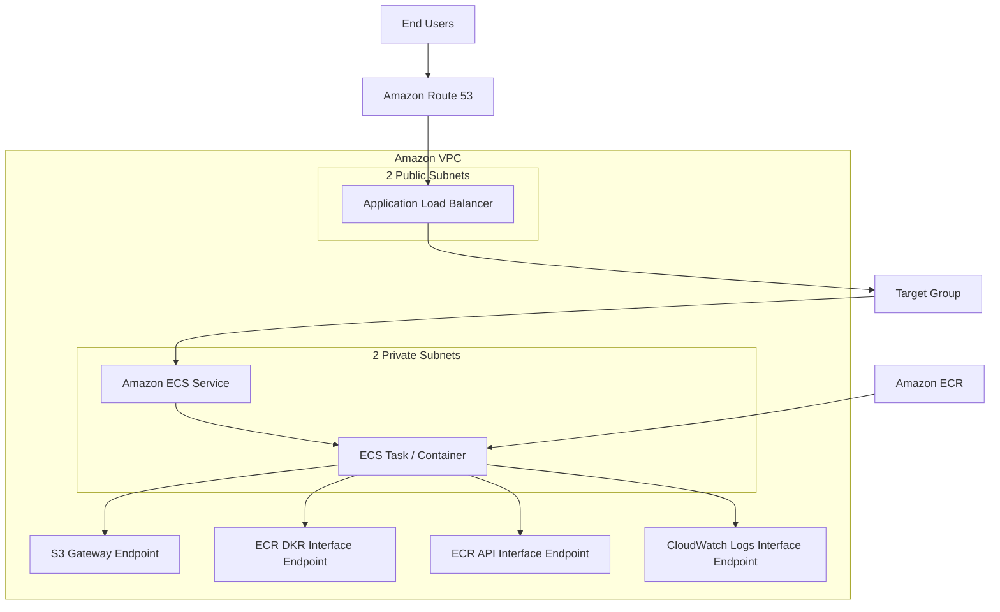

# Portfolio Application Deployment on AWS ECS

## Project Overview

This project demonstrates the deployment of a containerized Portfolio Web Application on Amazon Web Services (AWS) using Amazon Elastic Container Service (ECS).

The application was containerized using Docker, stored in Amazon Elastic Container Registry (ECR), and deployed through ECS. An Application Load Balancer (ALB) was configured to distribute incoming application traffic to the ECS service through a Target Group. Amazon Route 53 was used for DNS configuration.

Additionally, VPC Endpoints were configured to provide private connectivity between ECS workloads and supported AWS services such as Amazon S3, Amazon ECR, and CloudWatch Logs.

This project demonstrates practical knowledge of AWS networking, containerization, cloud infrastructure, and application deployment.

## AWS Architecture

## AWS Services Used

| AWS Service | Purpose |
|---|---|
| Amazon VPC | Provides isolated cloud networking |
| Public Subnets | Host internet-facing infrastructure |
| Private Subnets | Provide private networking for application resources |
| VPC Endpoints | Enable private connectivity to supported AWS services |
| S3 Gateway Endpoint | Provides private access to Amazon S3 |
| ECR DKR Endpoint | Enables private Docker registry connectivity |
| ECR API Endpoint | Provides private access to Amazon ECR API |
| CloudWatch Logs Endpoint | Enables private application log delivery |
| Security Groups | Control inbound and outbound traffic |
| Amazon ECR | Stores Docker container images |
| Amazon ECS | Runs and manages containerized applications |
| ECS Task Definition | Defines container image, port mappings, and runtime settings |
| ECS Service | Maintains the desired number of running tasks |
| Application Load Balancer | Distributes incoming HTTP/HTTPS traffic |
| Target Groups | Routes traffic to registered ECS tasks |
| Amazon Route 53 | Manages domain name resolution |

## Project Implementation

### 1. VPC Configuration

- Created an Amazon VPC to provide an isolated network environment.
- Configured 2 Public Subnets and 2 Private Subnets.
- Distributed subnets across Availability Zones.
- Configured public subnets for internet-facing infrastructure such as the Application Load Balancer.
- Configured private subnets for application resources as per the deployment architecture.
- Configured the required network connectivity for ECS application deployment.

**VPC Network Configuration:**

| Subnet Type | Quantity | Purpose |
|---|---:|---|
| Public Subnets | 2 | Host internet-facing Application Load Balancer |
| Private Subnets | 2 | Provide private networking for ECS application resources |

**Screenshot:**

### 2. Security Group Configuration

Configured AWS Security Groups to control inbound traffic and manage communication between the internet, Application Load Balancer, and ECS application.

**Inbound Security Group Rules:**

| Type | Protocol | Port | Source | Purpose |
|---|---|---:|---|---|
| HTTP | TCP | 80 | 0.0.0.0/0 | Allow HTTP traffic |
| HTTPS | TCP | 443 | 0.0.0.0/0 | Allow HTTPS traffic |

- Configured HTTP on port 80 to accept web traffic.
- Configured HTTPS on port 443 to support secure web traffic.
- Configured communication between the Application Load Balancer and ECS tasks as required.
- Restricted application traffic to the ALB security group where applicable.

**Screenshot:**

### 3. VPC Endpoints Configuration

Configured VPC Endpoints to establish private connectivity between resources in the VPC and supported AWS services without requiring traffic to traverse the public internet.

**VPC Endpoints Created:**

| VPC Endpoint | Endpoint Type | AWS Service Name | Purpose |
|---|---|---|---|
| Amazon S3 | Gateway | com.amazonaws.<region>.s3 | Provides private access to Amazon S3 |
| ECR Docker (ecr.dkr) | Interface | com.amazonaws.<region>.ecr.dkr | Enables Docker registry connectivity |
| ECR API (ecr.api) | Interface | com.amazonaws.<region>.ecr.api | Provides private access to ECR API operations |
| CloudWatch Logs (logs) | Interface | com.amazonaws.<region>.logs | Enables application log delivery |

**Configuration Details:**

- Created an S3 Gateway Endpoint and associated it with the required route tables.
- Created an ECR Docker Interface Endpoint for private Docker registry communication.
- Created an ECR API Interface Endpoint for private ECR API access.
- Created a CloudWatch Logs Interface Endpoint for application log delivery.
- Configured endpoint security groups to allow HTTPS traffic on TCP port 443 from required VPC resources.
- Enabled private DNS for Interface Endpoints where appropriate.
- Configured private connectivity between ECS workloads and supported AWS services.

**Benefits of VPC Endpoints:**

- Reduces dependency on public internet connectivity.
- Enables private access to supported AWS services.
- Supports secure container image retrieval from Amazon ECR.
- Enables application log delivery to CloudWatch Logs through private connectivity.
- Helps improve the network security of the ECS deployment.

**Screenshot:**

### 4. Docker Image and Amazon ECR

- Created a Docker image for the Portfolio Application.
- Created an Amazon ECR repository.
- Authenticated Docker with Amazon ECR.
- Tagged the Docker image.
- Pushed the Docker image to the ECR repository.

**Screenshot:**

### 5. Amazon ECS Configuration

- Created an ECS cluster.
- Created an ECS Task Definition.
- Configured the container image using the ECR repository.
- Configured the application container port (Port 80).
- Created an ECS Service to run and manage the application.
- Configured the desired number of running tasks.

**Screenshots:**

### 6. Application Load Balancer Configuration

- Created an Application Load Balancer.
- Configured the ALB in the public subnets.
- Configured listeners for incoming application traffic.
- Integrated the ALB with the ECS service through a Target Group.
- Configured HTTP and HTTPS listeners as implemented.

**Screenshot:**

### 7. Target Group Configuration

- Created a Target Group for the ECS application.
- Configured the application traffic port.
- Configured health check settings.
- Integrated the Target Group with the ECS Service.
- Verified the health status of registered ECS task targets.

**Screenshot:**

### 8. Route 53 DNS Configuration

- Created a Route 53 hosted zone for the project domain.
- Configured DNS records to connect the custom domain with the application endpoint.
- Used DNS configuration to make the portfolio application accessible through the domain name.

**Screenshot:**

### 9. Application Deployment and Testing

- Deployed the Portfolio Application using Amazon ECS.
- Used the Docker image stored in Amazon ECR.
- Integrated ECS with the Application Load Balancer.
- Tested application accessibility through the load balancer endpoint and configured domain.
- Verified ECS task and container status.

**Application Screenshot:**

## Deployment Workflow

1. Develop the Portfolio Application.
2. Create a Dockerfile.
3. Build the Docker image.
4. Create an Amazon ECR repository.
5. Authenticate Docker with ECR.
6. Push the Docker image to ECR.
7. Create an Amazon VPC.
8. Configure 2 Public Subnets and 2 Private Subnets.
9. Configure Security Groups with HTTP (80) and HTTPS (443) rules.
10. Create VPC Endpoints for S3, ECR DKR, ECR API, and CloudWatch Logs.
11. Create an ECS Cluster.
12. Configure the ECS Task Definition.
13. Create an ECS Service.
14. Create an Application Load Balancer.
15. Configure the Target Group and Health Checks.
16. Integrate the ALB with the ECS Service.
17. Configure Route 53 DNS records.
18. Test application accessibility.

## Key Learnings

- Hands-on experience with AWS cloud infrastructure.
- Understanding VPC networking and subnet architecture.
- Practical experience configuring public and private subnets.
- Understanding Security Groups and inbound traffic rules.
- Configuring Gateway and Interface VPC Endpoints.
- Understanding private connectivity to Amazon S3, ECR, and CloudWatch Logs.
- Docker image creation and container deployment.
- Practical experience with Amazon ECR and ECS.
- Configuring Application Load Balancers and Target Groups.
- Understanding DNS management using Route 53.
- Troubleshooting container deployment and application connectivity.

## Technologies Used

- **Cloud Platform:** Amazon Web Services (AWS)
- **Containerization:** Docker
- **Container Management:** Amazon ECS
- **Container Registry:** Amazon ECR
- **Networking:** Amazon VPC
- **Subnets:** Public and Private Subnets
- **VPC Endpoints:** S3 Gateway, ECR DKR, ECR API, CloudWatch Logs
- **Security:** AWS Security Groups
- **Load Balancing:** Application Load Balancer
- **Traffic Routing:** Target Groups
- **DNS Management:** Amazon Route 53
- **Version Control:** Git and GitHub

## Author

**Sai Varshith**

AWS Cloud | DevOps | Linux | Docker | Git & GitHub

GitHub: [Add your GitHub profile URL]

Portfolio: [Add your portfolio URL]

---

*This project was developed as a hands-on AWS cloud deployment project to demonstrate practical knowledge of cloud infrastructure, containerization, networking, private service connectivity, and DevOps technologies.*
