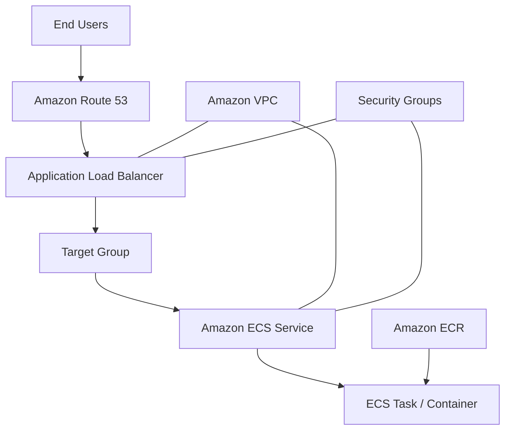

# Portfolio Application Deployment on AWS ECS

## Project Overview

This project demonstrates the deployment of a containerized Portfolio Web Application on Amazon Web Services (AWS) using Amazon Elastic Container Service (ECS).

The application was containerized using Docker, stored in Amazon Elastic Container Registry (ECR), and deployed through ECS. An Application Load Balancer (ALB) was configured to distribute incoming application traffic to the ECS service through a Target Group. Amazon Route 53 was used for DNS configuration.

The project demonstrates practical knowledge of AWS networking, containerization, application deployment, and cloud infrastructure.

## Architecture

## AWS Services Used

| AWS Service | Purpose |
|---|---|
| Amazon VPC | Provides isolated cloud networking |
| Security Groups | Controls inbound and outbound traffic |
| Amazon ECR | Stores Docker container images |
| Amazon ECS | Runs and manages containerized applications |
| ECS Task Definition | Defines container image, port mappings, and runtime settings |
| ECS Service | Maintains the desired number of running tasks |
| Application Load Balancer | Distributes incoming HTTP/HTTPS traffic |
| Target Groups | Routes traffic to registered ECS tasks |
| Amazon Route 53 | Manages domain name resolution |

## Project Implementation

### 1. VPC Configuration
- Created an Amazon VPC.
- Configured the required subnets and networking.
- Prepared network connectivity for the application deployment.

**Screenshot:**

### 2. Security Group Configuration
- Configured security groups for application traffic.
- Allowed the required inbound ports.
- Configured communication between the load balancer and application.

**Screenshot:**

### 3. Docker Image and Amazon ECR
- Created a Docker image for the Portfolio Application.
- Created an Amazon ECR repository.
- Authenticated Docker with Amazon ECR.
- Tagged and pushed the Docker image to ECR.

**Screenshot:**

### 4. Amazon ECS Configuration
- Created an ECS cluster.
- Created a task definition.
- Configured the container image using the ECR repository.
- Configured the application container port.
- Created an ECS service to run the application.

**Screenshots:**

### 5. Application Load Balancer
- Created an Application Load Balancer.
- Configured listeners.
- Integrated the load balancer with the ECS service through a Target Group.

**Screenshot:**

### 6. Target Group Configuration
- Created a Target Group.
- Configured the application traffic port.
- Configured health checks.
- Registered ECS task targets through the ECS service integration.

**Screenshot:**

### 7. Route 53 DNS Configuration
- Configured a hosted zone for the project domain.
- Worked on DNS records to connect the domain with the application endpoint.

**Screenshot:**

### 8. Application Deployment and Testing

- Deployed the Portfolio Application using Amazon ECS.
- Used the Application Load Balancer endpoint to access the application.
- Verified the application deployment and container status.

**Application Screenshot:**

## Deployment Workflow

1. Develop the Portfolio Application.
2. Create a Dockerfile.
3. Build the Docker image.
4. Create an ECR repository.
5. Push the Docker image to ECR.
6. Create an ECS cluster.
7. Configure the ECS task definition.
8. Create an ECS service.
9. Configure the Application Load Balancer.
10. Associate the Target Group with the ECS service.
11. Configure security groups and networking.
12. Configure Route 53 DNS records.
13. Test application accessibility.

## Key Learnings

- Hands-on experience with AWS cloud infrastructure.
- Understanding Docker image creation and container deployment.
- Practical experience with Amazon ECR and ECS.
- Understanding VPC networking and Security Groups.
- Configuring Application Load Balancers and Target Groups.
- Understanding DNS management using Route 53.
- Troubleshooting container deployment and application connectivity.

## Technologies Used

- Cloud Platform: Amazon Web Services (AWS)
- Containerization: Docker
- Container Management: Amazon ECS
- Image Registry: Amazon ECR
- Networking: Amazon VPC
- Load Balancing: Application Load Balancer
- DNS: Amazon Route 53
- Version Control: Git and GitHub

## Author

**Sai Varshith**

AWS Cloud | DevOps | Linux | Docker | Git & GitHub

GitHub: [Add your GitHub profile URL]

Portfolio: [Add your portfolio URL]

---

*This project was developed as a hands-on AWS cloud deployment project for learning and demonstrating practical cloud and DevOps skills.*
